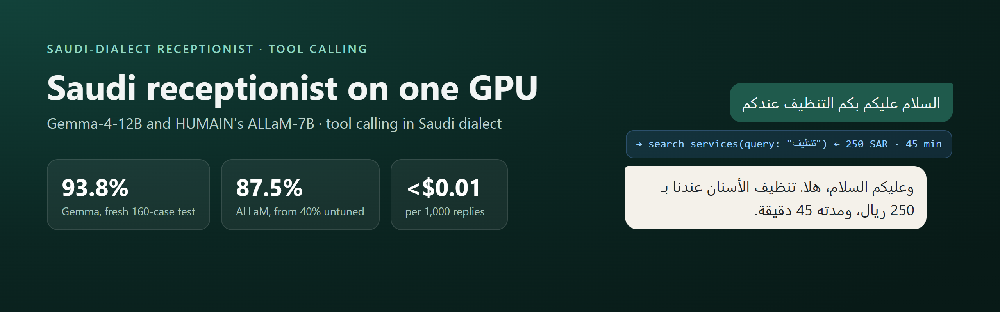
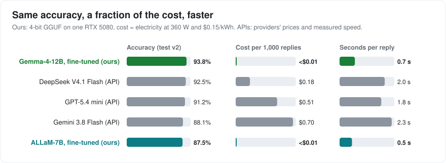
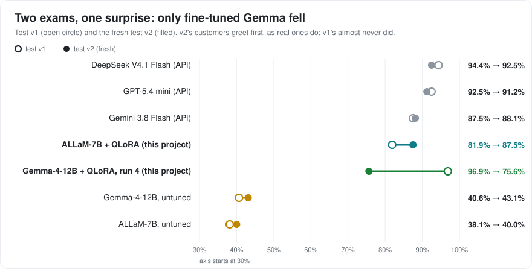
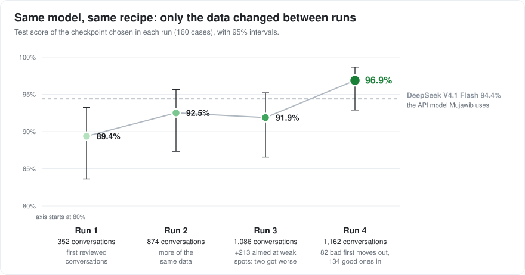
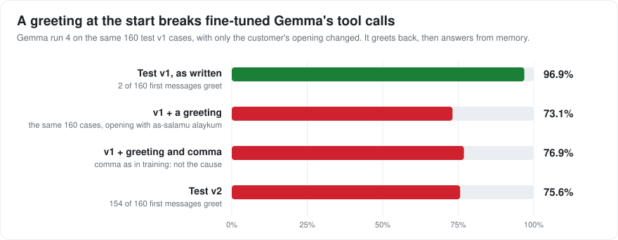
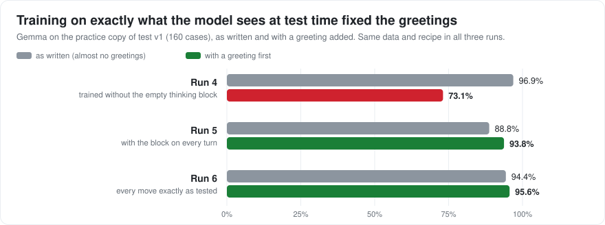
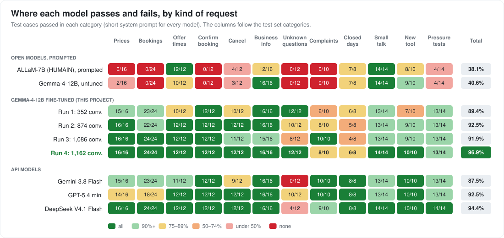
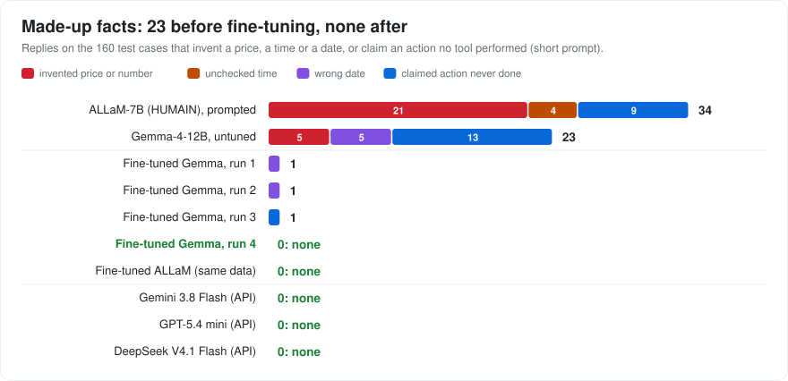

# Saudi-dialect receptionist: fine-tuning open models on one GPU



**TL;DR**

- I fine-tuned two open models, Google's **Gemma-4-12B** and HUMAIN's **ALLaM-7B**, on **one RTX 5080** to work as a
  WhatsApp receptionist for Saudi businesses: they answer in Saudi dialect and call booking tools (prices, free times,
  booking, cancelling, handing over to a person).
- On a fresh 160-case test, fine-tuned Gemma scores **93.8%**, level with DeepSeek V4.1 Flash (92.5%, the API model my
  company runs on) and GPT-5.4 mini (91.2%). ALLaM had no tool calling at all; fine-tuned, it scores **87.5%** (from 40%).
- Locally they answer in **0.5–0.7 s** for **under $0.01 per 1,000 replies**.
- The most useful finding: four hidden tokens in Gemma's chat format cost about 20 points on real-looking messages.
  Training each move on exactly the prompt it gets at inference fixed it.
- Everything is open: code, training data, both test sets, every raw result, and the models
  ([Gemma](https://huggingface.co/bnbasel/saudi-receptionist-gemma-4-12b),
  [ALLaM](https://huggingface.co/bnbasel/allam-7b-saudi-receptionist)).

**About.** I'm Basel, a CS student and the founder of Mujawib, an AI receptionist for Saudi businesses that runs on a
commercial API model today. This project asks whether a small open model, fine-tuned on a single consumer GPU, can do
the same job: call the tools correctly *and* write natural Saudi dialect. The tool-calling half is answered below; the
dialect half (a blind native-speaker review) is next.

## Results at a glance






## How it was built

1. **Choose the base model by measurement.** Five open models compared on Saudi-dialect text, GPU memory and a blind
   dialect test (Stage 2).
2. **Write the tests first.** Test v1: 160 cases in 12 kinds of request, reviewed by a native speaker and frozen with a
   checksum. Later a fresh test v2 at four new businesses, used only for final numbers (Stage 4).
3. **Measure the baselines.** Three API models and two untuned open models on the same cases, scored automatically on
   tool calls and invented facts (Stage 5).
4. **Make and curate the data.** 1,153 conversations drafted on DeepSeek V4.1 Flash by our own generation pipeline,
   under 51 rules written and refined through review, automatic checks and review (Stage 6).
5. **Fine-tune and learn from the data.** Six QLoRA runs, one change at a time: more data, then better data, then a
   format fix. Twelve checkpoints per run, chosen by a rule fixed in advance (Stage 7).
6. **Release and re-check.** GGUF builds re-tested through llama.cpp, LM Studio-style chat and Ollama, plus a local
   demo ([docs/RELEASE.md](docs/RELEASE.md)).

## Try it

- **Models:** both fine-tuned models as one-file GGUF downloads for LM Studio, llama.cpp and Ollama, plus the
  adapters, with model cards: [Gemma-4-12B](release/gemma/README.md), [ALLaM-7B](release/allam/README.md). Each file was
  re-tested before release, including through LM Studio-style chat and Ollama ([docs/RELEASE.md](docs/RELEASE.md)).
- **Demo:** [`release/demo/`](release/demo/) is a local chat page: write as a Saudi customer and watch the receptionist
  call its tools (prices, free times, booking) against a fake clinic calendar. Nothing leaves your PC.
- **ALLaM tool calling:** [`release/allam/allam_tools.py`](release/allam/allam_tools.py), a dependency-free helper for
  ALLaM's text tool format.

## Status

| Stage | What | Status |
|---|---|---|
| 0 | Big picture, machine check, repo setup | Done |
| 1 | Training environment on the RTX 5080 | Done (smoke test passes) |
| 2 | Base model choice | Done: [`google/gemma-4-12B-it`](https://huggingface.co/google/gemma-4-12B-it) (Apache-2.0) |
| 3 | Task spec: businesses, tools, style switches, data format | Done: [docs/TASK_SPEC.md](docs/TASK_SPEC.md) |
| 4 | Test sets: v1 (160 test + 40 dev cases, native-speaker reviewed) and a fresh v2 (160 cases, new businesses), both frozen | Done: [docs/TEST_SET.md](docs/TEST_SET.md), [docs/TEST_SET_V2.md](docs/TEST_SET_V2.md) |
| 5 | Benchmark harness and baselines | Done: results below |
| 6 | Training data: generation, automatic checks, review | 1,162 reviewed conversations used in run 4; 95–97% of each recent batch passes review |
| 7 | QLoRA fine-tuning | Test v2: Gemma-4-12B (run 6) **93.8%**, ALLaM-7B **87.5%**; API models 88–93% |
| Release | Model files, cards, demo | GGUF builds made and re-tested; model cards and a local demo ready ([docs/RELEASE.md](docs/RELEASE.md)); Hugging Face upload next |

Nothing below this line is claimed until it is done and verified. Results, dataset card and model card will be added when they exist.

## Details by stage

**Stage 2: choosing the base model.** Measured on our own Saudi-dialect text and on this GPU, not taken from vendor claims.

| Candidate | Tokens per word (Saudi probe) | Tool-call template | QLoRA peak VRAM at 1,024 tokens | Seconds per training step |
|---|---|---|---|---|
| ALLaM-7B-Instruct-preview | 1.79 | none | - | - |
| **Gemma-4-12B-it** | **2.22** | yes | **14.6 GB** | **7.8** |
| Fanar-1-9B-Instruct | 2.33 | none | - | - |
| Qwen3.5-9B | 2.34 | yes | 14.8 GB | 12.6 |
| Granite-4.2-8B | 4.21 | yes | - | - |

In a blind A/B test on 10 customer messages, judged by a native speaker before any fine-tuning, Gemma-4-12B-it won 9 and Qwen3.5-9B won 0 (1 tie). This is a small sample from one judge, used only to choose the base model. Details: [LEARNING.md](LEARNING.md#step-2--choosing-the-base-model), raw outputs in [`results/stage2/`](results/stage2/).

**Stage 4: the test set.** 160 test and 40 dev cases across 12 categories (prices, bookings with date phrases, cancellations, handoffs, closed hours, small talk, pressure tests, and a tool the model never sees in training). Each case is a conversation up to one decision plus the correct next step, scored automatically, with 42 cases for a blind native-speaker dialect review. Frozen on 2026-09-30:

| File | SHA-256 |
|---|---|
| `data/test/test_v1.jsonl` | `6fc684b157e5719567ba347525a26bc62a6646755a089c3f7393341b1d41935f` |
| `data/test/dev_v1.jsonl` | `6d1a148fe416b8d167ec0f50374ef86f4c78971ebd4e970f6b00a8aa5b095f8b` |

Check them with `sha256sum data/test/*_v1.jsonl` (Linux, macOS, Git Bash) or `Get-FileHash data/test/*_v1.jsonl -Algorithm SHA256` (PowerShell). Any change to the test set becomes a new version (`test_v2`), never a silent edit.

**Test v2: a fresh exam.** By Stage 7, v1 was partly used up: run 4's fix had been chosen by reading v1 failures. v2 has 160 new cases in the same 12 categories and counts, at four kinds of business that appear in neither v1 nor the training data (a padel club, a nutrition clinic, a henna studio and a phone repair shop), in a different week. The customer lines were drafted by Claude from a native speaker's style picks (a greeting on the first message, «ابي / ودي / بغيت / ممكن», spelling slips, both digit sets) and AI-reviewed against the native speaker's rules. Each model version runs on it once. Details: [docs/TEST_SET_V2.md](docs/TEST_SET_V2.md). Frozen on 2026-10-05:

| File | SHA-256 |
|---|---|
| `data/test/test_v2.jsonl` | `180b3356043e5bce9777ab9e8f1fe318a845801b4adb26ed8a98c4889da17150` |

**Stage 5: baselines.** Scored automatically on the 160 frozen test cases with scorer v1.3 (95% confidence interval in brackets). *Short* is the system prompt from [docs/TASK_SPEC.md](docs/TASK_SPEC.md), the one the fine-tuned model will use. *Long* adds the spec's behaviour rules written out in full (about 450 more tokens), frozen before its first test run.

| Model | How it ran | Short prompt | Long prompt | Hallucinated actions / dates / numbers / times (short prompt) |
|---|---|---|---|---|
| GPT-5.4 mini | OpenRouter (OpenAI, flex tier), thinking on, 2,048-token cap | 92.5% (87–96%) | **98.8%** (96–100%) | 0 / 0 / 0 / 0 |
| DeepSeek V4.1 Flash | OpenRouter (DeepInfra), thinking on, 2,048-token cap | **94.4%** (90–97%) | 98.1% (95–99%) | 0 / 0 / 0 / 0 |
| Gemini 3.8 Flash | OpenRouter (Google AI Studio, flex tier), thinking on, 2,048-token cap | 87.5% (81–92%) | 91.2% (86–95%) | 0 / 0 / 0 / 0 |
| Gemma-4-12B-it, untuned | local, 4-bit, greedy, thinking off | 40.6% (33–48%) | 44.4% (37–52%) | 13 / 5 / 5 / 0 |
| ALLaM-7B-Instruct-preview | local, 4-bit, greedy; no tool support in its template, so tools are described in text | 38.1% (31–46%) | 41.9% (35–50%) | 9 / 0 / 21 / 4 |

All API runs together cost under $0.60. DeepSeek V4.1 Flash is the model Mujawib runs on today, so it is the bar the fine-tuned model has to clear with the short prompt.

What the results show:
- **The API models use their tools well**, and a fully explained prompt lifts them further. Their main remaining weakness is questions nobody can answer: they search the service list instead of handing off to a person (Gemini on most of them, even with the long prompt).
- **The two open models almost never call a tool**, with either prompt: untuned Gemma made 5 tool calls in 160 cases with the long prompt, ALLaM 3. They pass on business info, small talk and closed hours, and fail on prices, bookings, cancellations and handoffs. ALLaM also invents prices freely (for example 1,500 riyals for a 900-riyal service) and offers times it never checked.
- **Better instructions are not enough for the open models:** the long prompt adds only about 4 points for Gemma and ALLaM. That is the gap fine-tuning has to close.

These scores only check tools and facts. Whether the replies sound like natural Saudi dialect is judged separately, in a blind review by a native speaker.

**Stage 7: fine-tuning.** Gemma-4-12B-it with QLoRA on the RTX 5080, the same recipe every time; only the reviewed data changed. Scores on test v1:

| Run | Training data | Test v1 score |
|---|---|---|
| 1 | 352 conversations | 89.4% |
| 2 | 874 conversations | 92.5% |
| 3 | 1,086: run 2's plus 213 aimed at its weak spots (closed days, unknown questions, complaints) | 91.9% |
| **4** | **1,162: run 3's minus 82 that taught a bad first move, plus 134 that show the right one** | **96.9%** |

For each run, twelve checkpoints were compared on the dev set and one was chosen by a rule fixed in advance (best dev score, ties broken by the lowest held-out loss), then run once on the test set.



- **The data's habits become the model's habits.** Adding more conversations about the weak spots (run 3) made two of them worse: in every closed-day conversation the teacher searched the service list before saying the day was closed, and the model learned that first move. Reviews passed those conversations because they read well as a whole. Removing them and adding conversations that open the right way (run 4) took unknown questions from 8 to 12 of 12 and closed days from 4 to 6 of 8 (run 3 → run 4: 10 cases won, 2 lost, p = 0.04).
- **Fine-tuning gave HUMAIN's ALLaM tool calling.** ALLaM-7B's chat template has no tool format, so its conversations were written with tool calls as text lines (`<tool_call>{...}</tool_call>`), and it was trained on exactly run 4's conversations with the same recipe (dev: 37/40 at checkpoint 414). To deploy it, a server needs the same template and a small parser for those lines.

**Test v2: the fresh exam.** Every model once, with the short prompt (the three API runs cost $0.22). Run 6 is v2's second Gemma run, after the fix explained below:

| Model | Test v1 | Test v2 (95% CI) | Made-up facts on v2 |
|---|---|---|---|
| **Gemma-4-12B + QLoRA, run 6 (this project)** | 94.4% | **93.8%** (89–97%) | 3 |
| **ALLaM-7B + QLoRA (this project)** | 81.9% | **87.5%** (81–92%) | 2 |
| Gemma-4-12B + QLoRA, run 4 (before the fix) | 96.9% | 75.6% (68–82%) | 10 |
| DeepSeek V4.1 Flash (API) | 94.4% | 92.5% (87–96%) | 0 |
| GPT-5.4 mini (API) | 92.5% | 91.2% (86–95%) | 2 |
| Gemini 3.8 Flash (API) | 87.5% | 88.1% (82–92%) | 0 |
| Gemma-4-12B-it, untuned | 40.6% | 43.1% (36–51%) | 16 |
| ALLaM-7B-Instruct, untuned | 38.1% | 40.0% (33–48%) | 33 |

- **The API and untuned models score about the same on both exams; only fine-tuned Gemma (run 4) fell**, by 21 points, in three categories: prices (16 → 7 of 16), unknown questions (12 → 0 of 12) and complaints (8 → 1 of 10).
- **A greeting caused it.** 154 of the 160 v2 messages open with a greeting, as real customers' do; only 2 of the 160 v1 messages did. On the same v1 cases with «السلام عليكم» added and nothing else changed, Gemma run 4 drops from 96.9% to 73.1%, failing the same three categories. The model greets back («وعليكم السلام، هلا والله») and then answers from memory, inventing the price. Adding a comma after the greeting changes little (76.9%). This was diagnosed on a practice copy of v1, without reading any v2 answer. The training data was not the cause: all 142 greeted price questions in it start with a search. The prompt format was (below).
- **Fine-tuned ALLaM is level with the API models** (against DeepSeek: 9 cases won, 17 lost, p = 0.17; GPT-5.4 mini p = 0.36; Gemini p = 1) and was clearly ahead of Gemma run 4 (32 won, 13 lost, p = 0.007) after the same training on the same data. It is the best of the seven on unknown questions (9 of 12; DeepSeek 2, Gemini 0). Its weak spot is business info (11 of 16): it hands questions the system prompt answers to a person.
- **Fine-tuning closed the gap that prompting could not.** On the fresh exam it adds 47 points to ALLaM and 51 to Gemma (run 6); a fully explained prompt adds about 4.
- **What test v1 got wrong about Gemma.** Its 96.9% held only for messages without a greeting, and run 4's fix had been chosen from v1's failures. v1 is now a practice set; the fresh exam is the number to trust.



**The fix: train exactly as you test (runs 5 and 6).** When the benchmark, or any server, asks Gemma for a new turn with thinking switched off, its chat template puts an empty thinking block (`<|channel>thought` … `<channel|>`) before the answer. A conversation rendered for training has none. So runs 1–4 made the first move of every turn from a position they had never been trained at: without a greeting what they had learned still carried over, and with a greeting the untuned habit of greeting back won. On the first moves of the 58 held-back training conversations (familiar businesses), run 4 got 25 right with the greeting, 56 with the greeting removed, and 57 with the greeting kept but the block taken out of the prompt.

- **Run 5** put the block at the start of every turn. Greetings were fixed (117 → 150 of 160 on the greeted practice set), but a later move in a turn, which the template replays *without* the block, now saw the mismatch instead, and bookings became unstable.
- **Run 6** shows each conversation twice: once with the blocks, training only the first move of each turn, and once without, training only the moves after a tool result. Every trained position then matches its test prompt exactly, and the build checks that it does. Same data, split and recipe as run 4. ALLaM's format has no thinking block and its training was built to match its test prompt from the start, which is why it never had the problem.
- **Run 6 on the fresh exam: 93.8%** (95% CI 89–97%), with 10 of 12 unknown questions and 10 of 10 complaints (run 4: 0 and 1). Level with DeepSeek V4.1 Flash (10 cases won, 8 lost, p = 0.81) and GPT-5.4 mini (12 won, 8 lost, p = 0.50), and ahead of fine-tuned ALLaM (15 won, 5 lost, p = 0.04) and run 4 (31 won, 2 lost).
- **Caveat:** this is v2's second Gemma run. The fix was diagnosed on practice sets without reading any v2 answer, but the search started because of v2's first result, so a third, untouched test set would give the cleanest number.
- **Training is not perfectly smooth.** A few batches produce very large updates ("gradient spikes"); one at step 145 of run 6 wrecked the next checkpoint (greeted dev 18/40) before the run recovered. That is why twelve checkpoints are compared with a rule fixed in advance.








Most of the gain arrives in the first pass over the data, for both models. Gemma runs 2 and 3 reach 40/40, the ceiling of the dev set, which is why the test set decides; run 4 settles at 38/40 on dev while scoring highest on test, a reminder that 40 cases is a small sample. Run 2 needed one engineering change: vocabulary scores are now computed only at the positions the loss grades, which cut peak GPU memory from 13.5 to 9.6 GB with an identical loss. These scores check tools and facts only; whether the replies sound natural is judged separately in the blind dialect review (Stage 8). Raw outputs: [`results/stage7/`](results/stage7/). Charts: `uv run python scripts/make_charts.py`.

**Known limitations so far.** The test messages are synthetic: v1's were reviewed and edited by one native speaker, and v2's were drafted by Claude and reviewed by an AI reviewer working from that native speaker's rules, so no native speaker read every v2 line and the two may share blind spots. Their phrasing is less varied than real customers'. The dialect verdicts come from one judge.

## Roadmap (plan, not results)

This is a comparison study as much as a fine-tune. The question is not only "did fine-tuning help?" but "is fine-tuning a small local model worth it compared with prompting strong models?"

| Stage | Plan |
|---|---|
| 5 | Benchmark harness: one script runs any model over the test set and scores it the same way. Competitors: API models with one shared prompt, other open Arabic models, and the base model with a prompt and with few-shot examples |
| 6 | Training data: licence audit, synthetic generation only where terms allow, automatic rule checks, review against rules written and calibrated by a native speaker, leakage check against the test set |
| 7 | QLoRA training on the RTX 5080, as a data comparison: **A** generated conversations only, **B** the same plus about 20% filtered human-written Saudi dialogues ([Voho](docs/DATA_SOURCES.md), no tools), and later **C** "dialect-first": training on Najdi web text before the task data. Compared on tool accuracy and blind dialect review |
| 8 | Evaluation: automatic tool-call checks, blind A/B dialect review, confidence intervals, cost and speed per reply |
| 9 | Publish: results table and charts (model vs model, short vs long prompt, before vs after fine-tuning), raw outputs per model, side-by-side conversation gallery, dataset card, model card with honest limitations |
| Next | Blind native-speaker dialect review (Stage 8); release of both fine-tuned models on Hugging Face with model cards and GGUF builds, re-tested through their own chat templates; a multi-turn test (whole conversations, judged by the final booking state); a test v3; Gemma 4 E2B (a small model) on the same data |
| Later | The same data on a larger model trained on rented cloud GPUs, to compare what model size buys; other regional dialects, each with its own test set |

Fairness rules for the comparison: every model sees the same test cases, tools and system-prompt format. Prompt-only competitors are tested with the short prompt the fine-tuned model uses **and** with a longer, fully explained version, and both results are reported. Prompts are tuned only on the dev set and frozen before any test result exists. Each API's terms are checked before its outputs are published.

## Reproduce

Tested on Windows 11, RTX 5080 (16 GB, sm_120), NVIDIA driver 610.88, with [uv](https://docs.astral.sh/uv/).

```bash
git config core.hooksPath .githooks   # enable the commit-message guard (once per clone)
uv sync                               # Python 3.12 + torch 2.12.1+cu130 + training libraries, from uv.lock
uv run python scripts/smoke_test.py   # GPU, sm_120 kernels, 4-bit, and a tiny QLoRA training run
```

## Learning log

This is also a learning project. See [LEARNING.md](LEARNING.md) for each step explained, and [GLOSSARY.md](GLOSSARY.md) for the terms.

## Licence

Code: [Apache-2.0](LICENSE). Datasets and model weights will carry their own licences, recorded per source.
