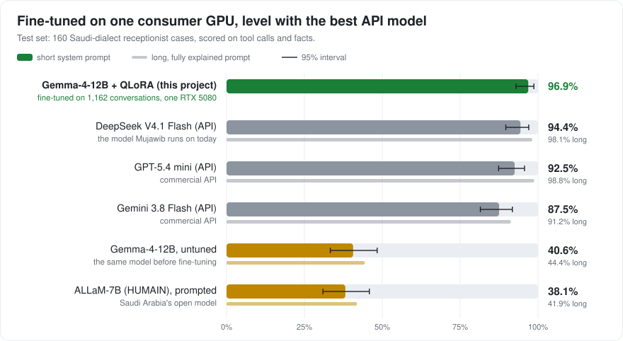
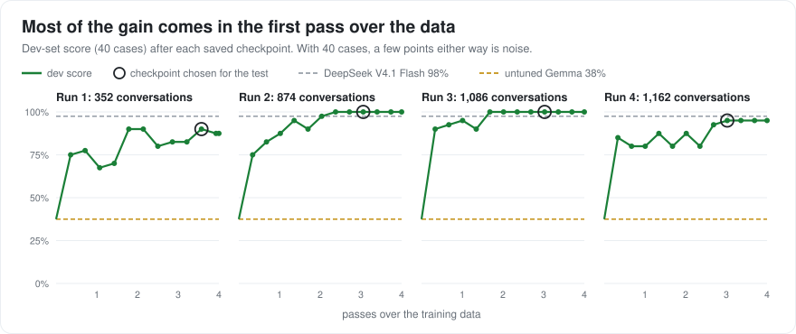

# saudi-dialect

## Why this project

I'm the founder of Mujawib, an AI agent receptionist for Saudi businesses. Today it runs on a large commercial API model. This project asks whether a small open model, fine-tuned on a single consumer GPU, can write more natural Saudi dialect *and* call booking tools correctly, and beat both that API model and Saudi Arabia's own open ALLaM model on a public, reproducible test set.

## What it does

Fine-tuning a small open model (Gemma-4-12B) with QLoRA on one consumer GPU (RTX 5080, 16 GB) so that it:

1. writes natural Saudi dialect the way a friendly receptionist texts on WhatsApp, and
2. calls tools correctly (price lookup, available times, booking) in the same conversation.

The goal is to beat both the untuned base model and a strong API baseline on a held-out test set, judged by a blind A/B dialect review from a native speaker plus automatic tool-call checks.

## Status

| Stage | What | Status |
|---|---|---|
| 0 | Big picture, machine check, repo setup | Done |
| 1 | Training environment on the RTX 5080 | Done (smoke test passes) |
| 2 | Base model choice | Done: [`google/gemma-4-12B-it`](https://huggingface.co/google/gemma-4-12B-it) (Apache-2.0) |
| 3 | Task spec: businesses, tools, style switches, data format | Done: [docs/TASK_SPEC.md](docs/TASK_SPEC.md) |
| 4 | Test set: 160 test + 40 dev cases, native-speaker reviewed, frozen | Done: [docs/TEST_SET.md](docs/TEST_SET.md) |
| 5 | Benchmark harness and baselines | Done: results below |
| 6 | Training data: generation, automatic checks, review | 874 reviewed-ok conversations; 95–97% of each recent batch passes review |
| 7 | QLoRA fine-tuning | Runs 1–3 done: 89.4% → 92.5% → 91.9% on the test set |

Nothing below this line is claimed until it is done and verified. Results, dataset card and model card will be added when they exist.

## Findings so far

**Stage 2: choosing the base model.** Measured on our own Saudi-dialect text and on this GPU, not taken from vendor claims.

| Candidate | Tokens per word (Saudi probe) | Tool-call template | QLoRA peak VRAM at 1,024 tokens | Seconds per training step |
|---|---|---|---|---|
| ALLaM-7B-Instruct-preview | 1.79 | none | - | - |
| **Gemma-4-12B-it** | **2.22** | yes | **14.6 GB** | **7.8** |
| Fanar-1-9B-Instruct | 2.33 | none | - | - |
| Qwen3.5-9B | 2.34 | yes | 14.8 GB | 12.6 |
| Granite-4.2-8B | 4.21 | yes | - | - |

In a blind A/B test on 10 customer messages, judged by a native speaker before any fine-tuning, Gemma-4-12B-it won 9 and Qwen3.5-9B won 0 (1 tie). This is a small sample from one judge, used only to choose the base model. Details: [LEARNING.md](LEARNING.md#step-2--choosing-the-base-model), raw outputs in [`results/stage2/`](results/stage2/).

**Stage 4: the test set.** 160 test and 40 dev cases across 12 categories (prices, bookings with date phrases, cancellations, handoffs, closed hours, small talk, pressure tests, and a tool the model never sees in training). Each case is a conversation up to one decision plus the correct next step, scored automatically, with 42 cases for a blind native-speaker dialect review. Frozen on 2026-09-30:

| File | SHA-256 |
|---|---|
| `data/test/test_v1.jsonl` | `6fc684b157e5719567ba347525a26bc62a6646755a089c3f7393341b1d41935f` |
| `data/test/dev_v1.jsonl` | `6d1a148fe416b8d167ec0f50374ef86f4c78971ebd4e970f6b00a8aa5b095f8b` |

Check them with `sha256sum data/test/*_v1.jsonl` (Linux, macOS, Git Bash) or `Get-FileHash data/test/*_v1.jsonl -Algorithm SHA256` (PowerShell). Any change to the test set becomes a new version (`test_v2`), never a silent edit.

**Stage 5: baselines.** Scored automatically on the 160 frozen test cases with scorer v1.3 (95% confidence interval in brackets). *Short* is the system prompt from [docs/TASK_SPEC.md](docs/TASK_SPEC.md), the one the fine-tuned model will use. *Long* adds the spec's behaviour rules written out in full (about 450 more tokens), frozen before its first test run.

| Model | How it ran | Short prompt | Long prompt | Hallucinated actions / dates / numbers / times (short prompt) |
|---|---|---|---|---|
| GPT-5.4 mini | OpenRouter (OpenAI, flex tier), thinking on, 2,048-token cap | 92.5% (87–96%) | **98.8%** (96–100%) | 0 / 0 / 0 / 0 |
| DeepSeek V4.1 Flash | OpenRouter (DeepInfra), thinking on, 2,048-token cap | **94.4%** (90–97%) | 98.1% (95–99%) | 0 / 0 / 0 / 0 |
| Gemini 3.8 Flash | OpenRouter (Google AI Studio, flex tier), thinking on, 2,048-token cap | 87.5% (81–92%) | 91.2% (86–95%) | 0 / 0 / 0 / 0 |
| Gemma-4-12B-it, untuned | local, 4-bit, greedy, thinking off | 40.6% (33–48%) | 44.4% (37–52%) | 13 / 5 / 5 / 0 |
| ALLaM-7B-Instruct-preview | local, 4-bit, greedy; no tool support in its template, so tools are described in text | 38.1% (31–46%) | 41.9% (35–50%) | 9 / 0 / 21 / 4 |

All API runs together cost under $0.60. DeepSeek V4.1 Flash is the model Mujawib runs on today, so it is the bar the fine-tuned model has to clear with the short prompt.

What the results show:
- **The API models use their tools well**, and a fully explained prompt lifts them further. Their main remaining weakness is questions nobody can answer: they search the service list instead of handing off to a person (Gemini on most of them, even with the long prompt).
- **The two open models almost never call a tool**, with either prompt: untuned Gemma made 5 tool calls in 160 cases with the long prompt, ALLaM 3. They pass on business info, small talk and closed hours, and fail on prices, bookings, cancellations and handoffs. ALLaM also invents prices freely (for example 1,500 riyals for a 900-riyal service) and offers times it never checked.
- **Better instructions are not enough for the open models:** the long prompt adds only about 4 points for Gemma and ALLaM. That is the gap fine-tuning has to close.

These scores only check tools and facts. Whether the replies sound like natural Saudi dialect is judged separately, in a blind review by a native speaker.

**Stage 7: fine-tuning (runs 1–3).** Gemma-4-12B-it with QLoRA on the RTX 5080, the same recipe every time; only the reviewed data changed: 352 conversations in run 1 (33 minutes), 874 in run 2 (about 80 minutes), and 1,086 in run 3: 873 of run 2's plus 213 aimed at the weak spots of run 2 (closed days, questions nobody can answer, complaints). For each run, twelve checkpoints were compared on the dev set; one was chosen by a rule fixed in advance (best dev score, ties broken by the lowest held-out loss) and run once on the test set.



| Model | Test score (160 cases) | 95% CI |
|---|---|---|
| ALLaM-7B-Instruct (HUMAIN), prompted | 38.1% short / 41.9% long prompt | 31–46% / 35–50% |
| Gemma-4-12B-it, untuned | 40.6% short / 44.4% long prompt | 33–48% / 37–52% |
| Gemma-4-12B-it + QLoRA, run 1 (352 conversations) | 89.4% | 84–93% |
| **Gemma-4-12B-it + QLoRA, run 2 (874 conversations)** | **92.5%** | **87–96%** |
| Gemma-4-12B-it + QLoRA, run 3 (1,086, weak spots added) | 91.9% | 87–95% |
| Gemini 3.8 Flash (API) | 87.5% | 81–92% |
| GPT-5.4 mini (API) | 92.5% | 87–96% |
| DeepSeek V4.1 Flash (API) | 94.4% | 90–97% |

- **Fine-tuning closed the gap that prompting could not.** The untuned model gains 4 points from a fully explained prompt; fine-tuning adds 52. Prices went from 2 to 16 of 16 and bookings from 0 to 22 of 24.
- **Level with GPT-5.4 mini, locally and at no cost per reply.** Run 2 passes 148 of 160 cases, the same as GPT-5.4 mini, and 3 fewer than DeepSeek V4.1 Flash, the model Mujawib runs on today.
- **More data helped, but the test gain alone is not proof.** Against run 1, run 2 fixed 11 test cases and broke 6. On 160 cases that net +5 could still be chance (paired McNemar test, p = 0.33). The steadier signal is the dev curve below: run 2 held 40/40 for its last six checkpoints, where run 1 moved between 32 and 36.
- **More than twice the score of Saudi Arabia's ALLaM on this task.** ALLaM-7B (HUMAIN) is smaller than Gemma-4-12B and was prompted, not fine-tuned, so this compares a task-trained model with a general one. The fair next comparison is ALLaM fine-tuned on the same data (on the roadmap).
- **More data on a weak spot can make it worse.** Run 3 fixed complaints (8 → 10 of 10, better than DeepSeek) and bookings (22 → 24 of 24), but closed days fell from 5 to 4 of 8 and unknown questions from 10 to 8 of 12. In both, the model now searches the service list first. The training data teaches exactly that: all 35 closed-day conversations in the first set, and 75% in the new one, open with a service search before saying the day is closed. The reviews passed them because the conversations read well as a whole; only the first move is wrong. Overall, runs 2 and 3 are the same (McNemar p = 1.0).



Most of the gain arrives in the first pass over the data. With 2.5 times the data, run 2 keeps improving into the third pass and then holds at 40/40, the ceiling of the dev set, which is why the test set decides. Run 2 needed one engineering change: vocabulary scores are now computed only at the positions the loss grades, which cut peak GPU memory from 13.5 to 9.6 GB with an identical loss. These scores check tools and facts only; whether the replies sound natural is judged separately in the blind dialect review (Stage 8). Raw outputs: [`results/stage7/`](results/stage7/). Charts: `uv run python scripts/make_charts.py`.

**Known limitations so far.** The test messages are synthetic drafts reviewed and edited by one native speaker, so their phrasing is less varied than real customers. The dialect verdicts come from one judge.

## Roadmap (plan, not results)

This is a comparison study as much as a fine-tune. The question is not only "did fine-tuning help?" but "is fine-tuning a small local model worth it compared with prompting strong models?"

| Stage | Plan |
|---|---|
| 5 | Benchmark harness: one script runs any model over the test set and scores it the same way. Competitors: API models with one shared prompt, other open Arabic models, and the base model with a prompt and with few-shot examples |
| 6 | Training data: licence audit, synthetic generation only where terms allow, automatic rule checks, review against rules written and calibrated by a native speaker, leakage check against the test set |
| 7 | QLoRA training on the RTX 5080, as a data comparison: **A** generated conversations only, **B** the same plus about 20% filtered human-written Saudi dialogues ([Voho](docs/DATA_SOURCES.md), no tools), and later **C** "dialect-first": training on Najdi web text before the task data. Compared on tool accuracy and blind dialect review |
| 8 | Evaluation: automatic tool-call checks, blind A/B dialect review, confidence intervals, cost and speed per reply |
| 9 | Publish: results table and charts (model vs model, short vs long prompt, before vs after fine-tuning), raw outputs per model, side-by-side conversation gallery, dataset card, model card with honest limitations |
| Later | ALLaM-7B (HUMAIN) fine-tuned on the same data, for a like-for-like comparison with Saudi Arabia's own model |
| Later | The same data on a larger model trained on rented cloud GPUs, to compare what model size buys; other regional dialects, each with its own test set |

Fairness rules for the comparison: every model sees the same test cases, tools and system-prompt format. Prompt-only competitors are tested with the short prompt the fine-tuned model uses **and** with a longer, fully explained version, and both results are reported. Prompts are tuned only on the dev set and frozen before any test result exists. Each API's terms are checked before its outputs are published.

## Reproduce

Tested on Windows 11, RTX 5080 (16 GB, sm_120), NVIDIA driver 610.88, with [uv](https://docs.astral.sh/uv/).

```bash
git config core.hooksPath .githooks   # enable the commit-message guard (once per clone)
uv sync                               # Python 3.12 + torch 2.12.1+cu130 + training libraries, from uv.lock
uv run python scripts/smoke_test.py   # GPU, sm_120 kernels, 4-bit, and a tiny QLoRA training run
```

## Learning log

This is also a learning project. See [LEARNING.md](LEARNING.md) for each step explained, and [GLOSSARY.md](GLOSSARY.md) for the terms.

## Licence

Code: [Apache-2.0](LICENSE). Datasets and model weights will carry their own licences, recorded per source.
