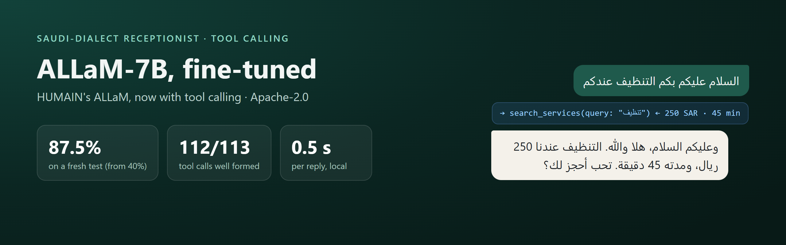
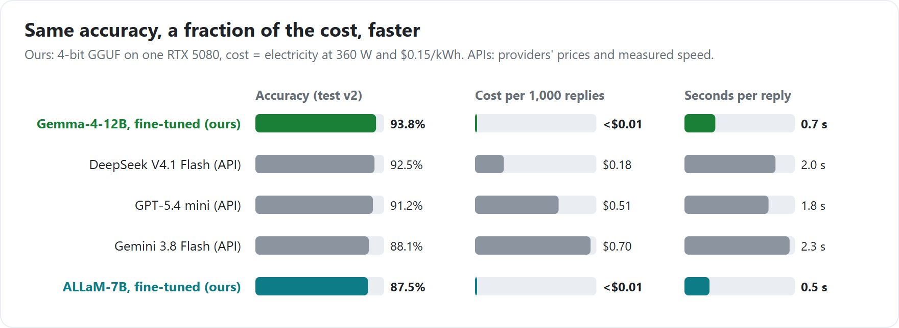
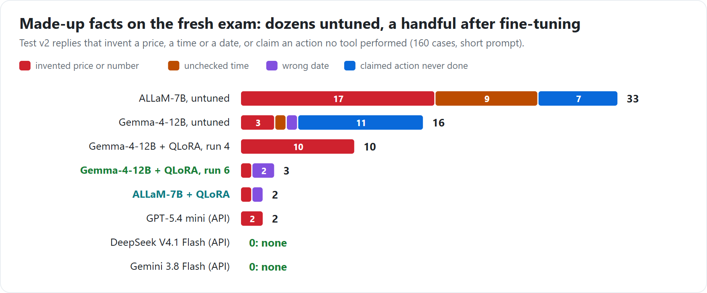

# Saudi receptionist · ALLaM-7B, fine-tuned

**TL;DR**

- HUMAIN's [ALLaM-7B-Instruct](https://huggingface.co/humain-ai/ALLaM-7B-Instruct-preview) has no tool-calling format.
  After fine-tuning on 1,153 conversations it makes **112 of 113 tool calls correctly** and works as a Saudi-dialect
  WhatsApp receptionist: prices, free times, booking, cancelling, handing over to a person.
- On a fresh 160-case test it scores **87.5%** (untuned: 40.0%), level with GPT-5.4 mini (91.2%) and Gemini 3.8 Flash
  (88.1%).
- Fine-tuned with QLoRA on **one RTX 5080** in about an hour. Runs locally in **0.5 s per reply**, for **under $0.01 per
  1,000 replies** in electricity.
- Built by **Basel**, a CS student and the founder of Mujawib (AI receptionists for Saudi
  businesses). Code, data and every result: [GitHub](https://github.com/bn-basel/mujawib-receptionist-finetune).

## Results




Each test case is one decision in a conversation: call the right tool with the right arguments, or reply without
inventing anything. Scoring is automatic. The test above (test v2) uses four businesses the model never saw in
training. Against the API models the differences are within chance (paired McNemar: GPT-5.4 mini p = 0.36, Gemini
p = 1, DeepSeek p = 0.17).



It is strongest on cancellations (12/12), complaints (10/10) and unknown questions handed to a person (9/12, against
2/12 for DeepSeek). It is weakest on questions the business information already answers (11/16), where it sometimes
hands over instead of answering.

## How it was built

1. **Define the job.** Twelve kinds of customer request (prices, bookings with date phrases like «بكره العصر»,
   cancelling, business info, complaints, closed days, small talk, pressure tests…), six tools, and fictional
   businesses backed by a fake booking system.
2. **Build the tests before training.** Test v1: 160 cases, reviewed by a native speaker, frozen with a checksum. Test
   v2: 160 fresh cases at four new businesses, used only for final numbers.
3. **Make the training data.** 1,153 conversations at 40 fictional businesses, drafted on DeepSeek V4.1 Flash by our own
   generation pipeline under 51 rules written and refined through review, then filtered by automatic checks and
   reviewed. No real customer data.
4. **Give ALLaM a tool format.** ALLaM's chat template has none, so tool calls are written as one text line,
   `<tool_call>{"name": ..., "arguments": {...}}</tool_call>`, and results come back as `<tool_result>...</tool_result>`.
   Training on this format is what taught it tool calling.
5. **Fine-tune.** QLoRA on the 4-bit model (LoRA rank 16) on one RTX 5080, about an hour. Twelve checkpoints were
   compared on a separate dev set, with the selection rule fixed in advance.
6. **Check the release files.** The GGUF builds were re-tested three ways (the original prompts, llama-server's chat
   API as LM Studio uses it, and Ollama) and score the same within noise. Their built-in chat template gives exactly
   the training prompt in 320 of 320 cases.

## Use it

| File | Size | For |
|---|---|---|
| `allam-7b-saudi-receptionist-Q4_K_M.gguf` | 4.0 GB | laptops and small GPUs |
| `allam-7b-saudi-receptionist-Q8_0.gguf` | 6.9 GB | best quality |
| `adapter_model.safetensors` + `adapter_config.json` | 0.16 GB | Transformers + PEFT, on top of the base model |
| `allam_tools.py` | | builds the tool format and parses the replies (no dependencies) |

```python
from allam_tools import to_allam_messages, parse_tool_calls

messages = to_allam_messages(system_prompt, conversation, tools)   # OpenAI-style conversation and tool list
reply = chat(messages)                                              # any server that applies ALLaM's chat template
text, calls = parse_tool_calls(reply)                               # [{"name": ..., "arguments": {...}}]
```

Use `allam_tools.py` as it is: its short tool guide is the wording the model was trained on.

```bash
# llama.cpp (LM Studio works the same way with the GGUF)
llama-server -m allam-7b-saudi-receptionist-Q4_K_M.gguf -ngl 99 -c 4096 --jinja

# Ollama (Modelfile.allam is in this repository; send the messages from allam_tools, without "tools")
ollama create allam-saudi-receptionist -f Modelfile.allam
```

<details>
<summary><b>Transformers example</b></summary>

```python
from transformers import AutoModelForCausalLM, AutoTokenizer
from peft import PeftModel
from allam_tools import to_allam_messages

tok = AutoTokenizer.from_pretrained("humain-ai/ALLaM-7B-Instruct-preview")
model = AutoModelForCausalLM.from_pretrained("humain-ai/ALLaM-7B-Instruct-preview", device_map="auto")
model = PeftModel.from_pretrained(model, "bnbasel/allam-7b-saudi-receptionist")

prompt = tok.apply_chat_template(to_allam_messages(system_prompt, conversation, tools),
                                 add_generation_prompt=True, tokenize=False)
```
</details>

<details>
<summary><b>System prompt and tools it was trained with</b></summary>

One system prompt per business, built by
[`scripts/prompt.py`](https://github.com/bn-basel/mujawib-receptionist-finetune/blob/main/scripts/prompt.py):

```text
You are نورة (female), WhatsApp receptionist of عيادة ابتسامة المروج لطب الأسنان, a dental clinic in الرياض.
Now: الاثنين 2026-10-05 18:40. Prayer times: Asr 15:12, Maghrib 17:41, Isha 19:11.
Address: ... Map: ...
Hours: Sun-Thu 16:00-23:00; Fri-Sat closed
- cancel or reschedule free up to 6 hours before
- payment: cash, mada, Apple Pay
Style: Relaxed everyday Saudi ... No emojis at all. Use masculine forms unless ...
Rules: General Saudi dialect only, short WhatsApp messages. Prices, times and bookings only from tools; never invent. ...
```

Tools ([schemas](https://github.com/bn-basel/mujawib-receptionist-finetune/blob/main/spec/tools.json)):
`search_services`, `get_available_slots`, `create_booking`, `get_my_bookings`, `cancel_booking`, `handoff_to_human`.
New tools can be added in the same format: given a tool it never saw in training (`reschedule_booking`), it passed 9 of
10 cases.
</details>

<details>
<summary><b>Training details</b></summary>

- 1,153 conversations: 1,095 for training, 58 held back (the same split as the Gemma model, for a fair comparison).
- ALLaM's own chat template with the text tool format; the loss covers only the receptionist's turns and their
  end-of-turn token. Every training prompt matches the inference prompt exactly.
- QLoRA: 4-bit NF4 base, LoRA rank 16, alpha 32, dropout 0.05, all linear layers; learning rate 2e-4 with a cosine
  schedule; 8 examples per step; 4 passes (548 steps); 5.4 GB of GPU memory.
- Chosen checkpoint: 414 of 548 (dev 37/40).
- GGUF: the adapter merged into the 16-bit base while converting with llama.cpp (b11457), Q8_0, then Q4_K_M.

| Re-test on test v1 (as written / with a greeting) | Score |
|---|---|
| Original (adapter on the 4-bit base) | 131 / 147 |
| GGUF Q8_0 | 129 / 146 |
| GGUF Q4_K_M | 134 / 149 |
| Q4_K_M through llama-server chat · through Ollama (greeted) | 152 · 145 |
</details>

## Limits

- The tests are synthetic. Test v1 was reviewed by one native speaker; test v2 was drafted by an LLM from that speaker's
  style choices and AI-reviewed. Real customers write with more variety.
- Each test case is one decision, not a whole conversation; multi-turn reliability is the next thing to measure.
- Scores check tools and facts, not how natural the dialect sounds (a blind native-speaker review is planned).
- It occasionally states a wrong fact (2 of 160 fresh cases). In production, check prices, times and dates in a reply
  against the tool results before sending it.

**Licence:** Apache-2.0, as the base model (its Hugging Face page is tagged `apache-2.0`; its card mentions a LICENSE
file that is not in the repository, checked 2026-10-07).
**Sister model:** [Gemma-4-12B, fine-tuned the same way](https://huggingface.co/bnbasel/saudi-receptionist-gemma-4-12b),
93.8% on the same test.
