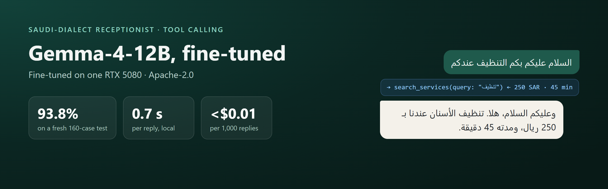
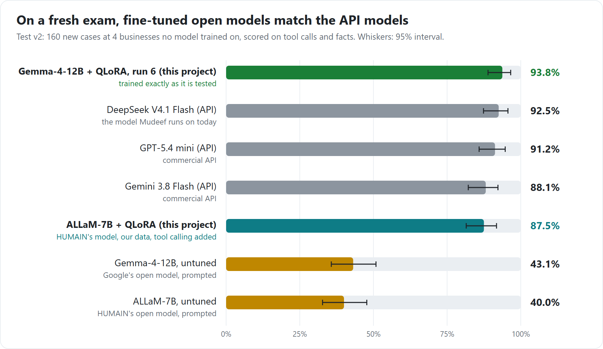
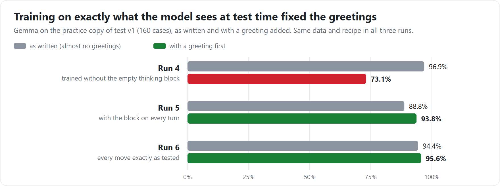

# Saudi receptionist · Gemma-4-12B, fine-tuned

**TL;DR**

- A WhatsApp receptionist for Saudi businesses: it answers in Saudi dialect and calls booking tools (prices, free
  times, booking, cancelling, handing over to a person).
- Fine-tuned from Google's Gemma-4-12B with QLoRA on **one RTX 5080**.
- On a fresh 160-case test it scores **93.8%**, level with DeepSeek V4.1 Flash (92.5%) and GPT-5.4 mini (91.2%).
  Untuned, the same model scores 43.1%.
- Runs locally in **0.7 s per reply**, for **under $0.01 per 1,000 replies** in electricity.
- Built by **Basel**, a CS/AI student at the University of Melbourne and the founder of Mudeef, an AI agent
  receptionist platform. Code, data and every result: [GitHub](https://github.com/bn-basel/saudi-receptionist-finetune).

## Results




Each test case is one decision in a conversation: call the right tool with the right arguments, or reply without
inventing anything. Scoring is automatic. The test above (test v2) uses four businesses the model never saw in
training. Against DeepSeek the difference is within chance (10 cases won, 8 lost; paired McNemar p = 0.81).

## How it was built

1. **Define the job.** Twelve kinds of customer request (prices, bookings with date phrases like «بكره العصر»,
   cancelling, business info, complaints, closed days, small talk, pressure tests…), six tools, and fictional
   businesses backed by a fake booking system.
2. **Build the tests before training.** Test v1: 160 cases, reviewed by a native speaker, frozen with a checksum. Test
   v2: 160 fresh cases at four new businesses, used only for final numbers.
3. **Make the training data.** 1,153 conversations at 40 fictional businesses, drafted on DeepSeek V4.1 Flash by our own
   generation pipeline under 51 rules written and refined through review, then filtered by automatic checks and
   reviewed. No real customer data.
4. **Fine-tune.** QLoRA on the 4-bit model (LoRA rank 16) on one RTX 5080, about 3.5 hours. Twelve checkpoints were
   compared on a separate dev set, with the selection rule fixed in advance.
5. **Find and fix a hidden bug.** The first version scored 97% on test v1 but 76% on the fresh test. A controlled
   experiment found the trigger: when a customer opens with «السلام عليكم», it greeted back and made up an answer
   instead of calling a tool. The cause was four hidden tokens: with thinking switched off, Gemma's chat format puts an
   empty thinking block before each answer at inference time, and the training text never had it. Training each move
   on exactly the prompt it gets at inference fixed it:

   

6. **Check the release files.** The GGUF builds were re-tested three ways (the original prompts, llama-server's chat
   API as LM Studio uses it, and Ollama) and score the same within noise.

## Use it

| File | Size | For |
|---|---|---|
| `saudi-receptionist-gemma-4-12b-Q8_0.gguf` | 11.8 GB | best quality (recommended) |
| `saudi-receptionist-gemma-4-12b-Q4_K_M.gguf` | 6.9 GB | smaller GPUs; may cost a little accuracy |
| `adapter_model.safetensors` + `adapter_config.json` | 0.26 GB | Transformers + PEFT, on top of `google/gemma-4-12B-it` |

**Keep thinking switched off**, as in training: `enable_thinking=False` in Transformers,
`"chat_template_kwargs": {"enable_thinking": false}` with llama-server, `"think": false` with Ollama.

```bash
# llama.cpp (LM Studio works the same way with the GGUF)
llama-server -m saudi-receptionist-gemma-4-12b-Q8_0.gguf -ngl 99 -c 4096 --jinja

# Ollama (Modelfile.gemma is in this repository)
ollama create saudi-receptionist-gemma -f Modelfile.gemma
```

<details>
<summary><b>Transformers example</b></summary>

```python
from transformers import AutoModelForCausalLM, AutoTokenizer
from peft import PeftModel

tok = AutoTokenizer.from_pretrained("google/gemma-4-12B-it")
model = AutoModelForCausalLM.from_pretrained("google/gemma-4-12B-it", device_map="auto")
model = PeftModel.from_pretrained(model, "bnbasel/saudi-receptionist-gemma-4-12b")

messages = [{"role": "system", "content": system_prompt}] + conversation
prompt = tok.apply_chat_template(messages, tools=tools, add_generation_prompt=True,
                                 enable_thinking=False, tokenize=False)
```
</details>

<details>
<summary><b>System prompt and tools it was trained with</b></summary>

One system prompt per business, built by
[`scripts/prompt.py`](https://github.com/bn-basel/saudi-receptionist-finetune/blob/main/scripts/prompt.py):

```text
You are نورة (female), WhatsApp receptionist of عيادة ابتسامة المروج لطب الأسنان, a dental clinic in الرياض.
Now: الاثنين 2026-10-05 18:40. Prayer times: Asr 15:12, Maghrib 17:41, Isha 19:11.
Address: ... Map: ...
Hours: Sun-Thu 16:00-23:00; Fri-Sat closed
- cancel or reschedule free up to 6 hours before
- payment: cash, mada, Apple Pay
Style: Relaxed everyday Saudi ... No emojis at all. Use masculine forms unless ...
Rules: General Saudi dialect only, short WhatsApp messages. Prices, times and bookings only from tools; never invent. ...
```

Tools ([schemas](https://github.com/bn-basel/saudi-receptionist-finetune/blob/main/spec/tools.json)):
`search_services`, `get_available_slots`, `create_booking`, `get_my_bookings`, `cancel_booking`, `handoff_to_human`,
in Gemma's own tool format. Given a tool it never saw in training (`reschedule_booking`), it passed 9 of 10 cases.
</details>

<details>
<summary><b>Training details</b></summary>

- 1,153 conversations: 1,095 for training, 58 held back.
- Gemma's chat template with thinking off. Each conversation is shown twice: once with the empty thinking block at
  the start of each turn (only each turn's first move is trained), and once as the template replays it (only the moves
  after a tool result are trained). Every trained position matches its inference prompt exactly; the build checks it.
- Loss only on the receptionist's words, tool calls and end-of-turn tokens.
- QLoRA: 4-bit NF4 base, LoRA rank 16, alpha 32, dropout 0.05, all linear layers; learning rate 2e-4 with a cosine
  schedule; 16 examples per step; 4 passes (524 steps); peak 9.3 GB of GPU memory.
- Chosen checkpoint: 440 of 524 (dev 39/40, greeted dev 39/40).
- GGUF: the adapter merged into the 16-bit base while converting with llama.cpp (b11457), Q8_0, then Q4_K_M.

| Re-test on test v1 (as written / with a greeting) | Score |
|---|---|
| Original (adapter on the 4-bit base) | 151 / 153 |
| GGUF Q8_0 | 154 / 154 |
| GGUF Q4_K_M | 153 / 148 |
| Q4_K_M through llama-server chat · through Ollama (greeted) | 148 · 149 |
</details>

## Limits

- The tests are synthetic. Test v1 was reviewed by one native speaker; test v2 was drafted by an LLM from that speaker's
  style choices and AI-reviewed. Real customers write with more variety.
- Each test case is one decision, not a whole conversation; multi-turn reliability is the next thing to measure.
- Scores check tools and facts, not how natural the dialect sounds (a blind native-speaker review is planned).
- It occasionally states a wrong fact (3 of 160 fresh cases, mostly dates). In production, check prices, times and
  dates in a reply against the tool results before sending it.
- This is test v2's second Gemma run; the fix was diagnosed on practice sets, but the search began because of the
  first result.

**Licence:** Apache-2.0, as the base model ([Gemma 4 licence](https://ai.google.dev/gemma/docs/gemma_4_license)).
**Sister model:** [ALLaM-7B, fine-tuned the same way](https://huggingface.co/bnbasel/allam-7b-saudi-receptionist).
